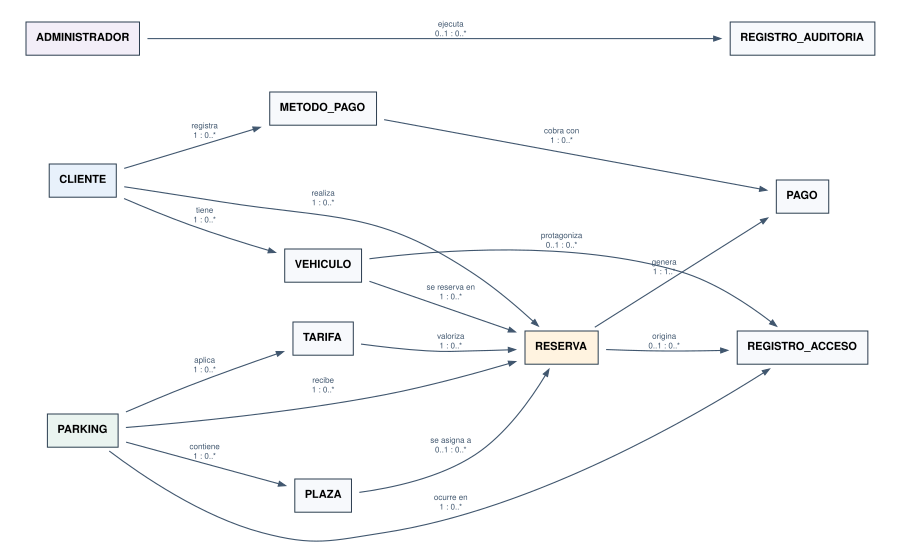
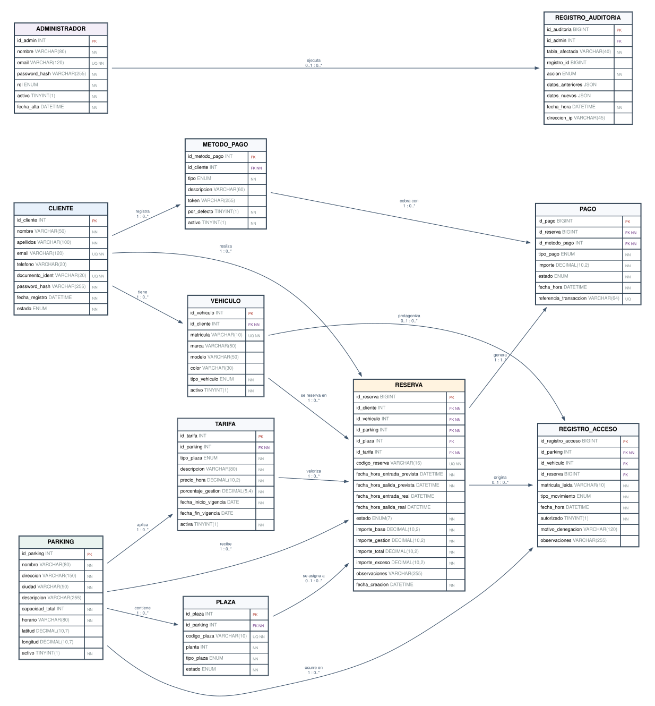

# Modelo lógico de la base de datos · Sprint 2

**Proyecto:** Tarraco Parkings · ASIX2 0379 · Grupo 6
**Sprint:** 2 · aplicación web de reserva de plazas
**Motor:** MariaDB 10.11
**Fuente del esquema:** `db/init.sql`

---

## 1. Qué resuelve este documento

Este documento describe la base de datos **completa a nivel lógico**: las entidades, sus atributos, las claves, las relaciones con sus cardinalidades y las reglas de integridad. No es un inventario de tablas SQL.

La distinción importa. El modelo relacional dice qué tablas hay y cómo se llaman sus columnas. El modelo lógico dice, además, **qué se conecta con qué, con qué cardinalidad y por qué**. Sin esa segunda parte no se puede comprobar si el diseño cubre los casos de uso ni si una reserva puede quedar sin plaza o un pago sin reserva.

Las dos indicaciones de los profesores después de la presentación del Sprint 1 se aplican aquí de forma literal:

1. **Fuera el hardware.** El proyecto es solo software. No se modela ningún equipo de los parkings, ni lectores de matrícula, ni controladores de barrera, ni estructura de red. La entidad `DISPOSITIVO` del Sprint 1 desaparece.
2. **El modelo lógico va en la planificación.** Este documento acompaña a la planificación del Sprint 2 y contiene todas las conexiones entidad-relación, no solo el DDL.

---

## 2. Vista general

El modelo tiene **11 entidades, 15 relaciones y 15 claves foráneas**. Se organiza en cuatro bloques:

- **Cuentas:** `CLIENTE`, `VEHICULO`, `METODO_PAGO`.
- **Oferta:** `PARKING`, `PLAZA`, `TARIFA`.
- **Operación:** `RESERVA`, `PAGO`, `REGISTRO_ACCESO`.
- **Gestión:** `ADMINISTRADOR`, `REGISTRO_AUDITORIA`.

`RESERVA` es el centro del modelo. Concentra cinco claves foráneas (cliente, vehículo, parking, plaza y tarifa) y de ella cuelgan los pagos y los registros de acceso.



*Figura 1. Relaciones y cardinalidades. Cada flecha va de la entidad que tiene la clave primaria a la que lleva la clave foránea, con la cardinalidad mínima y máxima en los dos extremos.*

---

## 3. Entidades y atributos

Convenciones de las tablas: `PK` clave primaria, `FK` clave foránea, `UQ` valor único, `NN` obligatorio (NOT NULL).

### 3.1 CLIENTE

Persona física que reserva. La baja es lógica (`estado`), nunca un borrado, porque sus reservas deben conservarse.

| Atributo | Tipo | Clave | Nulo | Para qué |
|---|---|---|---|---|
| id_cliente | INT UNSIGNED | PK | No | Identificador interno |
| nombre | VARCHAR(50) | | No | Nombre |
| apellidos | VARCHAR(100) | | No | Apellidos |
| email | VARCHAR(120) | UQ | No | Usuario de acceso |
| telefono | VARCHAR(20) | | Sí | Contacto |
| documento_ident | VARCHAR(20) | UQ | No | DNI o NIE |
| password_hash | VARCHAR(255) | | No | Hash bcrypt, nunca la contraseña |
| fecha_registro | DATETIME | | No | Alta |
| estado | ENUM('ACTIVO','INACTIVO') | | No | Baja lógica |

### 3.2 VEHICULO

Vehículo de un cliente. La matrícula es única en todo el sistema porque es la llave que usa el control de acceso.

| Atributo | Tipo | Clave | Nulo | Para qué |
|---|---|---|---|---|
| id_vehiculo | INT UNSIGNED | PK | No | Identificador |
| id_cliente | INT UNSIGNED | FK | No | Propietario |
| matricula | VARCHAR(10) | UQ | No | Matrícula normalizada |
| marca | VARCHAR(50) | | Sí | Marca |
| modelo | VARCHAR(50) | | Sí | Modelo |
| color | VARCHAR(30) | | Sí | Color |
| tipo_vehiculo | ENUM('COCHE','MOTO','ADAPTADO','CARGA') | | No | Determina el tipo de plaza compatible |
| activo | TINYINT(1) | | No | Baja lógica |

### 3.3 METODO_PAGO

Método tokenizado del cliente. **No se guarda ningún número de tarjeta**, solo el token que devuelve la pasarela.

| Atributo | Tipo | Clave | Nulo | Para qué |
|---|---|---|---|---|
| id_metodo_pago | INT UNSIGNED | PK | No | Identificador |
| id_cliente | INT UNSIGNED | FK | No | Titular |
| tipo | ENUM('TARJETA','TRANSFERENCIA','PAYPAL','BIZUM') | | No | Medio |
| descripcion | VARCHAR(60) | | Sí | Texto para el usuario |
| token | VARCHAR(255) | | Sí | Referencia de la pasarela |
| por_defecto | TINYINT(1) | | No | Método preseleccionado |
| activo | TINYINT(1) | | No | Baja lógica |

### 3.4 PARKING

Recinto con plazas. Solo se guardan datos descriptivos y de capacidad: no hay inventario de equipos ni planos de red.

| Atributo | Tipo | Clave | Nulo | Para qué |
|---|---|---|---|---|
| id_parking | INT UNSIGNED | PK | No | Identificador |
| nombre | VARCHAR(80) | | No | Nombre comercial |
| direccion | VARCHAR(150) | | No | Dirección |
| ciudad | VARCHAR(50) | | No | Ciudad |
| descripcion | VARCHAR(255) | | Sí | Texto informativo |
| capacidad_total | INT UNSIGNED | | No | Plazas del recinto |
| horario | VARCHAR(80) | | No | Horario de apertura |
| latitud | DECIMAL(10,7) | | Sí | Coordenada |
| longitud | DECIMAL(10,7) | | Sí | Coordenada |
| activo | TINYINT(1) | | No | Visible para los clientes |

### 3.5 PLAZA

Unidad reservable. El estado solo refleja la situación física (`LIBRE`, `OCUPADA`, `FUERA_SERVICIO`). La disponibilidad de una franja concreta se calcula con las reservas, no se guarda aquí.

| Atributo | Tipo | Clave | Nulo | Para qué |
|---|---|---|---|---|
| id_plaza | INT UNSIGNED | PK | No | Identificador |
| id_parking | INT UNSIGNED | FK | No | Parking al que pertenece |
| codigo_plaza | VARCHAR(10) | UQ+ | No | Código visible (A-01) |
| planta | INT | | No | Planta física |
| tipo_plaza | ENUM('ESTANDAR','ADAPTADA','ELECTRICA','CARGA','MOTO') | | No | Tipo de plaza |
| estado | ENUM('LIBRE','OCUPADA','FUERA_SERVICIO') | | No | Situación física actual |

`UQ+` indica una clave única compuesta: `(id_parking, codigo_plaza)`. El código A-01 puede repetirse en parkings distintos, pero no dentro del mismo.

### 3.6 TARIFA

Precio por hora de un tipo de plaza en un parking, con su porcentaje de gestión y su vigencia.

| Atributo | Tipo | Clave | Nulo | Para qué |
|---|---|---|---|---|
| id_tarifa | INT UNSIGNED | PK | No | Identificador |
| id_parking | INT UNSIGNED | FK | No | Parking |
| tipo_plaza | ENUM(...) | | No | Tipo al que aplica |
| descripcion | VARCHAR(80) | | No | Texto para el usuario |
| precio_hora | DECIMAL(10,2) | | No | Euros por hora |
| porcentaje_gestion | DECIMAL(5,4) | | No | Fracción: 0.1000 es el 10 % |
| fecha_inicio_vigencia | DATE | | No | Desde cuándo aplica |
| fecha_fin_vigencia | DATE | | Sí | Hasta cuándo aplica; nulo es sin fin |
| activa | TINYINT(1) | | No | Permite retirarla sin borrarla |

### 3.7 RESERVA

Núcleo del sistema. Guarda la franja prevista, la franja real, el estado y el precio congelado.

| Atributo | Tipo | Clave | Nulo | Para qué |
|---|---|---|---|---|
| id_reserva | BIGINT UNSIGNED | PK | No | Identificador |
| id_cliente | INT UNSIGNED | FK | No | Quién reserva |
| id_vehiculo | INT UNSIGNED | FK | No | Con qué vehículo |
| id_parking | INT UNSIGNED | FK | No | Dónde |
| id_plaza | INT UNSIGNED | FK | Sí | Plaza asignada; puede quedar sin asignar |
| id_tarifa | INT UNSIGNED | FK | No | Tarifa aplicada |
| codigo_reserva | VARCHAR(16) | UQ | No | Código legible |
| fecha_hora_entrada_prevista | DATETIME | | No | Inicio reservado |
| fecha_hora_salida_prevista | DATETIME | | No | Fin reservado |
| fecha_hora_entrada_real | DATETIME | | Sí | Entrada registrada |
| fecha_hora_salida_real | DATETIME | | Sí | Salida registrada |
| estado | ENUM(7 valores) | | No | Ciclo de vida |
| importe_base | DECIMAL(10,2) | | No | Horas por tarifa |
| importe_gestion | DECIMAL(10,2) | | No | 10 % de gestión |
| importe_total | DECIMAL(10,2) | | No | Suma de los dos anteriores |
| importe_exceso | DECIMAL(10,2) | | No | Cobro adicional por retraso |
| observaciones | VARCHAR(255) | | Sí | Notas |
| fecha_creacion | DATETIME | | No | Alta |

Los tres importes se congelan al crear la reserva. Si mañana sube la tarifa, la reserva de ayer conserva su precio. Es una redundancia deliberada y se explica en el apartado 7.

### 3.8 PAGO

Movimiento económico. Una reserva puede tener varios pagos: el de la reserva y uno o más de exceso.

| Atributo | Tipo | Clave | Nulo | Para qué |
|---|---|---|---|---|
| id_pago | BIGINT UNSIGNED | PK | No | Identificador |
| id_reserva | BIGINT UNSIGNED | FK | No | Reserva que lo origina |
| id_metodo_pago | INT UNSIGNED | FK | No | Con qué se cobra |
| tipo_pago | ENUM('RESERVA','EXCESO','PENALIZACION') | | No | Concepto |
| importe | DECIMAL(10,2) | | No | Euros |
| estado | ENUM('PENDIENTE','CONFIRMADO','FALLIDO','REEMBOLSADO') | | No | Situación |
| fecha_hora | DATETIME | | No | Momento |
| referencia_transaccion | VARCHAR(64) | UQ | Sí | Referencia de la pasarela |

### 3.9 REGISTRO_ACCESO

Traza de la simulación de entrada y salida. Se guarda **todo intento**, autorizado o denegado, con el motivo.

| Atributo | Tipo | Clave | Nulo | Para qué |
|---|---|---|---|---|
| id_registro_acceso | BIGINT UNSIGNED | PK | No | Identificador |
| id_parking | INT UNSIGNED | FK | No | Dónde ocurre |
| id_vehiculo | INT UNSIGNED | FK | Sí | Vehículo identificado, si existe |
| id_reserva | BIGINT UNSIGNED | FK | Sí | Reserva que autoriza el paso |
| matricula_leida | VARCHAR(10) | | No | Matrícula tecleada, tal cual |
| tipo_movimiento | ENUM('ENTRADA','SALIDA') | | No | Sentido |
| fecha_hora | DATETIME | | No | Momento |
| autorizado | TINYINT(1) | | No | Decisión del sistema |
| motivo_denegacion | VARCHAR(120) | | Sí | Por qué se denegó |
| observaciones | VARCHAR(255) | | Sí | Exceso cobrado, incidencias |

No hay `id_dispositivo` ni `barrera_abierta`: no existe ningún dispositivo que controlar. La matrícula se teclea en el formulario y la decisión es lógica.

### 3.10 ADMINISTRADOR

Cuenta del panel de gestión. Es una tabla separada de `CLIENTE` a propósito: un administrador no es un cliente con permisos.

| Atributo | Tipo | Clave | Nulo | Para qué |
|---|---|---|---|---|
| id_admin | INT UNSIGNED | PK | No | Identificador |
| nombre | VARCHAR(80) | | No | Nombre |
| email | VARCHAR(120) | UQ | No | Usuario |
| password_hash | VARCHAR(255) | | No | Hash bcrypt |
| rol | ENUM('SUPERADMIN','ADMIN','OPERADOR') | | No | Nivel |
| activo | TINYINT(1) | | No | Baja lógica |
| fecha_alta | DATETIME | | No | Alta |

### 3.11 REGISTRO_AUDITORIA

Traza de las acciones administrativas. Responde a quién cambió qué y cuándo.

| Atributo | Tipo | Clave | Nulo | Para qué |
|---|---|---|---|---|
| id_auditoria | BIGINT UNSIGNED | PK | No | Identificador |
| id_admin | INT UNSIGNED | FK | Sí | Autor; nulo si es el sistema |
| tabla_afectada | VARCHAR(40) | | No | Tabla tocada |
| registro_id | BIGINT UNSIGNED | | Sí | Fila afectada |
| accion | ENUM('CREAR','MODIFICAR','CANCELAR','LOGIN','LOGOUT') | | No | Qué se hizo |
| datos_anteriores | JSON | | Sí | Estado previo |
| datos_nuevos | JSON | | Sí | Estado nuevo |
| fecha_hora | DATETIME | | No | Momento |
| direccion_ip | VARCHAR(45) | | Sí | Origen, admite IPv6 |

---

## 4. Relaciones y cardinalidades

La notación es `mínima : máxima` en cada extremo. Una relación `1 : 0..*` significa que el extremo de la izquierda aporta exactamente un registro y el de la derecha puede aportar cero o muchos. La clave foránea se guarda siempre en el lado «muchos».

| # | Relación | Cardinalidad | Clave foránea | Regla de negocio |
|---|---|---|---|---|
| 1 | CLIENTE tiene VEHICULO | 1 : 0..* | `VEHICULO.id_cliente` | Un vehículo pertenece a un solo cliente |
| 2 | CLIENTE registra METODO_PAGO | 1 : 0..* | `METODO_PAGO.id_cliente` | Un método pertenece a un solo cliente |
| 3 | CLIENTE realiza RESERVA | 1 : 0..* | `RESERVA.id_cliente` | Un cliente puede no tener reservas |
| 4 | VEHICULO se reserva en RESERVA | 1 : 0..* | `RESERVA.id_vehiculo` | Cada reserva usa un vehículo del cliente |
| 5 | PARKING contiene PLAZA | 1 : 0..* | `PLAZA.id_parking` | Una plaza no cambia de parking |
| 6 | PARKING aplica TARIFA | 1 : 0..* | `TARIFA.id_parking` | Cada tarifa pertenece a un parking |
| 7 | PARKING recibe RESERVA | 1 : 0..* | `RESERVA.id_parking` | La reserva se hace contra un parking |
| 8 | PLAZA se asigna a RESERVA | 0..1 : 0..* | `RESERVA.id_plaza` | Una reserva puede quedarse sin plaza asignada |
| 9 | TARIFA valoriza RESERVA | 1 : 0..* | `RESERVA.id_tarifa` | El precio sale de una tarifa concreta |
| 10 | RESERVA genera PAGO | 1 : 1..* | `PAGO.id_reserva` | Toda reserva tiene al menos un pago |
| 11 | METODO_PAGO cobra con PAGO | 1 : 0..* | `PAGO.id_metodo_pago` | Cada pago usa un método |
| 12 | RESERVA origina REGISTRO_ACCESO | 0..1 : 0..* | `REGISTRO_ACCESO.id_reserva` | Un acceso puede no tener reserva |
| 13 | VEHICULO protagoniza REGISTRO_ACCESO | 0..1 : 0..* | `REGISTRO_ACCESO.id_vehiculo` | Una matrícula desconocida también se registra |
| 14 | PARKING ocurre en REGISTRO_ACCESO | 1 : 0..* | `REGISTRO_ACCESO.id_parking` | Todo acceso ocurre en un parking |
| 15 | ADMINISTRADOR ejecuta REGISTRO_AUDITORIA | 0..1 : 0..* | `REGISTRO_AUDITORIA.id_admin` | El sistema también puede dejar traza |

Las relaciones 12 y 13 son opcionales en el lado del acceso porque el sistema registra intentos con matrículas que no existen. Esa es la razón de que `id_vehiculo` y `id_reserva` admitan nulos.

La relación entre RESERVA y METODO_PAGO es indirecta, a través de PAGO. El Sprint 1 la tenía como clave foránea directa; en el Sprint 2 el método pertenece al pago, no a la reserva, porque una misma reserva puede tener varios pagos (el de la reserva y el del exceso) y no tiene por qué usar el mismo método en los dos.

La relación 10 tiene mínimo 1 por regla de negocio: la aplicación crea el pago dentro de la misma transacción que la reserva. La base de datos no puede exigir «al menos un hijo» sin un trigger adicional, y se ha preferido no añadirlo porque la transacción ya lo garantiza.



*Figura 2. El mismo modelo con todos los atributos. `PK` en rojo, `FK` en morado, `NN` obligatorio y `UQ` único.*

---

## 5. Reglas de integridad

### 5.1 Claves y unicidad

- `CLIENTE.email` y `CLIENTE.documento_ident` son únicos: no puede haber dos cuentas de la misma persona.
- `VEHICULO.matricula` es única en todo el sistema.
- `PLAZA(id_parking, codigo_plaza)` es única: el código se repite entre parkings, no dentro de uno.
- `RESERVA.codigo_reserva` es único.
- `PAGO.referencia_transaccion` es única cuando existe.

### 5.2 Integridad referencial

Todas las claves foráneas usan `ON DELETE RESTRICT` y `ON UPDATE CASCADE`.

`RESTRICT` es una decisión de negocio, no un descuido. Borrar un cliente con reservas dejaría el histórico huérfano, y borrar una reserva con pagos rompería la contabilidad. La baja se hace cambiando `estado` o `activo`.

`CASCADE` en la actualización permite corregir un identificador sin romper las referencias.

### 5.3 Restricciones CHECK

- `precio_hora >= 0` y `porcentaje_gestion` entre 0 y 1.
- `capacidad_total >= 0` y `planta` sin límite artificial.
- `fecha_hora_salida_prevista > fecha_hora_entrada_prevista`.
- `fecha_hora_salida_real >= fecha_hora_entrada_real` cuando ambas existen.
- Todos los importes son mayores o iguales que cero.
- La vigencia de una tarifa no termina antes de empezar.
- La matrícula tiene entre 4 y 10 caracteres.

### 5.4 Garantías en la base de datos

Dos reglas no se dejan en manos del código PHP porque cualquier cliente podría saltárselas. Están en `db/init.sql` como triggers:

- **`trg_reserva_sin_borrado`**: un `DELETE` sobre `RESERVA` falla con el mensaje «Las reservas no se borran nunca: solo cambian de estado».
- **`trg_reserva_transicion`**: solo permite las transiciones del ciclo de vida. Un `UPDATE` que intente pasar de `FINALIZADA` a `ACTIVA`, por ejemplo, falla.

Esto convierte el criterio «no borrar reservas» en una propiedad del sistema, no en una convención.

### 5.5 Reglas que aplica la capa de servicio

- El vehículo de una reserva debe pertenecer al cliente que la crea.
- La plaza se elige con `SELECT ... FOR UPDATE` dentro de una transacción: dos peticiones simultáneas no pueden recibir la misma.
- La tarifa se busca por parking y tipo de plaza, con la fecha de entrada dentro de la vigencia.
- El importe se calcula con horas completas o fracción, mínimo una hora.
- El exceso se cobra por horas completas o fracción, con 15 minutos de gracia.
- Una reserva cancelada reembolsa el pago confirmado.
- El administrador puede modificar fechas y plaza, pero no borrar.

---

## 6. Normalización

El modelo está en **tercera forma normal**.

- **1FN:** todos los atributos son atómicos. No hay listas empaquetadas en un campo; los vehículos, métodos de pago y pagos son filas propias.
- **2FN:** la clave primaria de cada tabla es simple (un `id`), así que no hay dependencias parciales.
- **3FN:** no hay dependencias transitivas. El nombre del parking no se repite en la reserva; se llega por `id_parking`. El precio por hora no se copia en cada pago; se llega por `id_tarifa`.

Hay **una redundancia deliberada**: `importe_base`, `importe_gestion` e `importe_total` se guardan en la reserva aunque se puedan recalcular. El motivo es histórico: el precio de una reserva no puede cambiar cuando sube la tarifa. Si se calculara al leer, una subida de precios reescribiría el pasado. Lo mismo pasa con `importe_exceso`.

La alternativa sería guardar una tarifa versionada y reconstruir el precio, pero eso complica las consultas y no aporta nada al negocio. Se documenta la redundancia y se acepta.

---

## 7. Ciclo de vida de la reserva

Siete estados y nueve transiciones permitidas:

```
PENDIENTE_PAGO ──► ACTIVA ──► EN_CURSO ──► FINALIZADA
       │              │            └─────► CON_EXCESO
       │              ├──────────► CANCELADA
       │              └──────────► NO_PRESENTADA
       └─────────────────────────► CANCELADA
```

- **PENDIENTE_PAGO:** creada, el pago aún no está confirmado.
- **ACTIVA:** pagada y con plaza. Es el único estado que autoriza la entrada.
- **EN_CURSO:** el vehículo ha entrado y está dentro.
- **FINALIZADA:** salida dentro del tiempo previsto.
- **CON_EXCESO:** salida tardía; el exceso se cobra en un pago aparte.
- **CANCELADA:** anulada antes de empezar, con reembolso.
- **NO_PRESENTADA:** pasada la hora de entrada más 30 minutos sin entrada real.

`FINALIZADA`, `CON_EXCESO`, `CANCELADA` y `NO_PRESENTADA` son terminales. No se vuelve de ellas.

---

## 8. Del modelo lógico al físico

`db/init.sql` traduce este documento a DDL de MariaDB. La correspondencia es directa:

- Cada entidad es una tabla `InnoDB` con `utf8mb4`.
- Cada relación es una clave foránea con nombre (`fk_*`).
- Cada regla de unicidad es un índice `UNIQUE`.
- Cada restricción de dominio es un `ENUM` o un `CHECK`.
- Las dos garantías del apartado 5.4 son triggers.

El archivo se ejecuta una sola vez, cuando el volumen de datos está vacío. Para volver a aplicarlo:

```bash
docker compose down -v
docker compose up -d
```

**Aviso:** `down -v` borra el volumen de MariaDB. En un entorno con datos reales, la vía es una copia de seguridad y una migración, no este comando.

---

## 9. Qué cambia respecto al Sprint 1

| Sprint 1 | Sprint 2 | Motivo |
|---|---|---|
| 10 entidades, incluida `DISPOSITIVO` | 11 entidades, sin `DISPOSITIVO` | Los profesores pidieron eliminar todo el hardware |
| `REGISTRO_ACCESO.id_dispositivo` | No existe | No hay lector físico que identificar |
| `barrera_abierta` en el acceso | No existe | No se controla ninguna barrera |
| Sin tabla de administradores | `ADMINISTRADOR` | El panel necesitaba cuentas propias |
| Sin auditoría | `REGISTRO_AUDITORIA` | Trazabilidad de los cambios del administrador |
| `RESERVA` sin `id_tarifa` | `RESERVA.id_tarifa` | El precio queda vinculado a la tarifa aplicada |
| `PLAZA.estado` con `RESERVADA` | Sin `RESERVADA` | La reserva ya lo dice; dos verdades se contradicen |
| 6 estados de reserva | 7 estados | Se añaden `EN_CURSO` y `NO_PRESENTADA` |

El Sprint 1 tenía 10 entidades contando `DISPOSITIVO`. Al quitarla quedan 9, y con las dos nuevas de gestión el Sprint 2 tiene 11. La guía interna habla de «10 tablas» y enumera 11: es una errata de la guía, no del modelo. La fuente que manda es `db/init.sql` y este documento.

---

## 10. Trazabilidad con las funciones de la aplicación

Cada función del Sprint 2 se apoya en una parte concreta del modelo. Esta tabla sirve para comprobar que no hay funciones huérfanas ni entidades decorativas.

| Función | Entidades y relaciones que usa |
|---|---|
| Registro y acceso de clientes | `CLIENTE` |
| Alta y baja de vehículos | `CLIENTE` 1 : 0..* `VEHICULO` |
| Consulta de parkings y plazas | `PARKING` 1 : 0..* `PLAZA` |
| Cálculo del precio | `TARIFA` 1 : 0..* `RESERVA` |
| Creación de la reserva | `RESERVA` con sus cinco claves foráneas |
| Pago simulado | `RESERVA` 1 : 1..* `PAGO`, `METODO_PAGO` 1 : 0..* `PAGO` |
| Entrada y salida | `REGISTRO_ACCESO` con `RESERVA`, `VEHICULO` y `PARKING` |
| Cobro del exceso | `RESERVA.importe_exceso` y un `PAGO` de tipo `EXCESO` |
| Panel de administración | `ADMINISTRADOR` y las entidades que consulta |
| Trazabilidad de cambios | `ADMINISTRADOR` 0..1 : 0..* `REGISTRO_AUDITORIA` |
| Cierre de no presentadas | `RESERVA` en estado `ACTIVA` |

---

## 11. Cómo se comprueba

```bash
# Estructura del DDL: claves, referencias, índices y columnas de los INSERT
python3 tests/check_schema.py

# Cálculo económico, sin base de datos
php tests/pricing_test.php

# Diagramas, a partir de la definición del modelo
node tools/gen-modelo.mjs
```

`check_schema.py` no sustituye a arrancar MariaDB, pero detecta lo que un error de tecleo rompe en silencio: una clave foránea que apunta a una tabla inexistente, un índice sobre una columna que no existe o un `INSERT` con una columna inventada. Cuando el stack esté levantado, `scripts/smoke-test.sh` comprueba además que los importes de las 20 reservas cuadran con su tarifa y que el trigger de borrado actúa.
